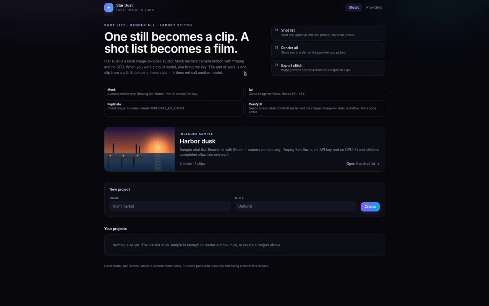
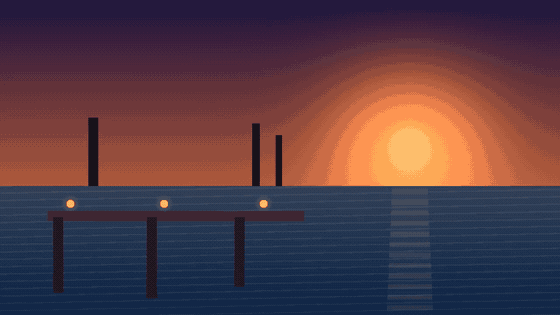
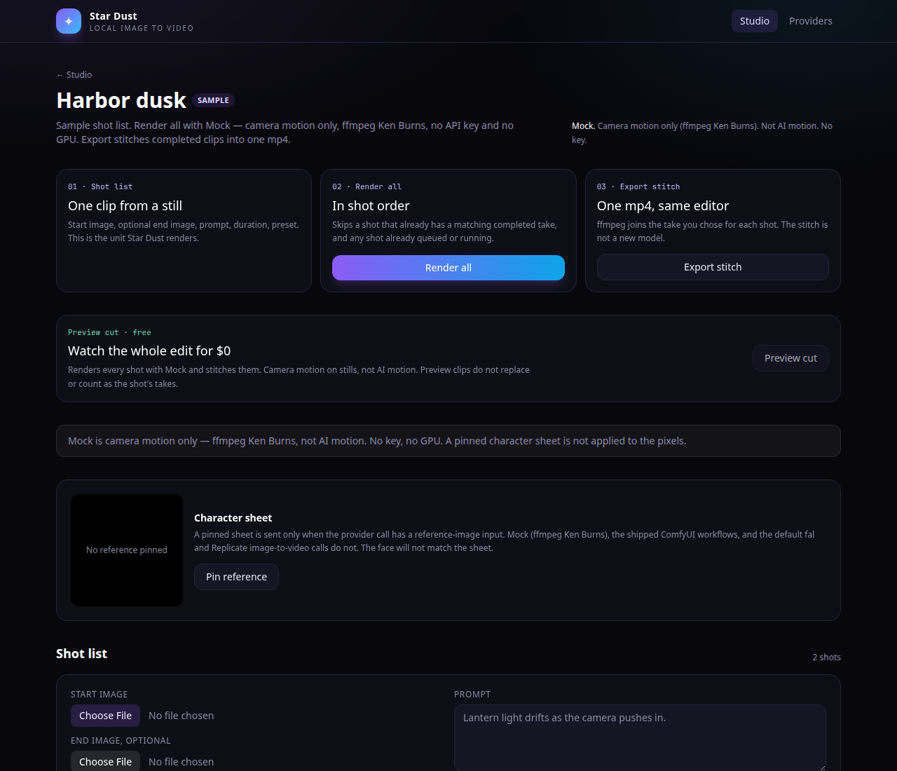

# Star Dust

Star Dust is a local image-to-video studio that works offline with ffmpeg and no GPU. `docker compose up --build` opens the included Harbor dusk sample: render a mock mp4 and download it.







Mock is camera motion only — a Ken Burns move on the still, not AI motion. The shot list is the product: one clip from a still, render the list in order, then export one stitched mp4. That stitch is ffmpeg. It is not another model.

## Which backend should I use?

Clone it and leave Mock on if you only want the shot list and a stitched mp4. The other rows are for when you want generated motion. None of them lock a character, lip-sync a performance, or turn the shot list into a long film. One clip is still the unit.

| Backend | Use it when | Hardware and keys |
| --- | --- | --- |
| Mock (free) | You want the edit with no GPU and no account. CI renders this. | ffmpeg only. Camera motion on the still, not AI motion. No key. |
| ComfyUI on this machine | ComfyUI is already running where Star Dust runs. | No key in Star Dust. Pick SVD, Wan 2.2 TI2V-5B, Wan 2.2 14B first-last frame, or LTX-2.3 per shot or per project. TI2V-5B stays the low-VRAM Wan path. Start with the low-memory preset. Memory notes are guidance, not a measured benchmark. |
| ComfyUI on another machine or a rented GPU | You do not have a card that can hold the model (an AMD iGPU laptop is the usual case). Run ComfyUI on a desktop or a rented GPU and point Star Dust at it. | Set `COMFYUI_BASE_URL`. If that host expects a header, set `COMFYUI_AUTH_HEADER`. Both stay in the environment. They are not saved in the database and not shown in the UI. |
| fal | You want a cloud clip and you already have a fal key. | `FAL_KEY` in the environment. A rate you type yourself, in the billing unit you pick. That total is your estimate, not a vendor quote. |
| Replicate | Same idea, on Replicate. | `REPLICATE_API_TOKEN` in the environment. Same kind of self-entered rate. |

## Docker

```bash
docker compose up --build
```

Open [http://localhost:3000](http://localhost:3000). Harbor dusk is already on the studio page, with two shots and a still. Leave the provider on **Mock**, choose **Render all**, then **Export stitch** or download the mp4.

The app listens on port 3000. Clips and the SQLite database stay in `./data` on the host. Keys are not baked into the image. Stripe, PayPal, and a license key are not required. If you later point at fal or Replicate, pass `FAL_KEY` or `REPLICATE_API_TOKEN` in the environment. For ComfyUI on another machine, pass `COMFYUI_BASE_URL` and, only if that server asks for it, `COMFYUI_AUTH_HEADER`. The image includes DejaVu Sans so caption burn-in has a font. If ffmpeg was built without the `subtitles` filter, burn-in stops and names libass instead of drawing nothing. A sidecar `.srt` does not need that filter.

## Providers

| Provider | What you need |
| --- | --- |
| Mock | No key. Camera motion only (ffmpeg Ken Burns). Not AI motion. |
| fal | `FAL_KEY` |
| Replicate | `REPLICATE_API_TOKEN` |
| ComfyUI | A reachable server, on this machine or at `COMFYUI_BASE_URL`. One of the shipped workflows. Not a node editor. |

Before a fal or Replicate job is created, Star Dust shows the model name. A key is required. Some vendors bill failed generations, and unused credits can expire. This app does not fetch a vendor price.

In Settings you can type a rate for each fal or Replicate model and pick the billing unit: per second, per clip, per 1M video tokens, or per megapixel of video. The rate is a plain setting, not a key. Before a paid render, Star Dust estimates each shot from that shot's still size, its duration, and 24 fps. Per second uses the duration. Per clip counts one clip. Video tokens are width × height × 24 × seconds ÷ 1024. Megapixels of video are width × height × 24 × seconds ÷ 1,000,000. An older rate with no unit stays per second. The shot list shows the total for every shot, what remaining takes add, and what a retake of an existing clip would add. The budget cap uses that same remaining-takes estimate. It is your own estimate, not a vendor quote. Star Dust has no vendor price table. If no rate is set, or a size-based unit cannot read the still, it says the cost is unknown and does not show a number. Mock and ComfyUI are not billed here.

If the key is missing, the job is not marked running. The error names `FAL_KEY` or `REPLICATE_API_TOKEN`.

ComfyUI posts the workflow you picked, polls `/history`, and downloads the video. If the server is down, the job fails with the URL and the status. An out-of-memory error, a missing node, or a missing model fails the job the same way. It does not sit on "running".

Check server on the Providers page calls `/system_stats`. When `COMFYUI_BASE_URL` is set, that check uses the environment host and does not print the URL. `COMFYUI_AUTH_HEADER` is sent as the `Authorization` value (override the header name with `COMFYUI_AUTH_HEADER_NAME`). The page shows whether the header is present. It never shows the value.

Pick the graph in Providers (the app default), on the project, or on a shot. A shot overrides the project, and the project overrides Providers. The low-memory preset is the same idea: start at about 480p, short clip. Each graph's card says what that preset actually writes.

**Stable Video Diffusion** (`workflows/comfyui-svd-i2v.api.json`) does not read the text prompt, and it does not take a second reference image. The job says so. It expects `svd_xt_1_1.safetensors` in `ComfyUI/models/checkpoints`. Core nodes only. Default size in the graph is 1024×576, with the shot duration mapped to about 14–25 frames at 6 fps. The low-memory preset uses 768×448 and 14 frames. There is no published system-RAM number here. It is the lightest of the shipped graphs.

**Wan 2.2 TI2V-5B** (`workflows/comfyui-wan22-ti2v-5b.api.json`) reads the prompt. Star Dust injects the start image, the prompt, a frame count from the shot duration (16 fps, snapped to the Wan 4n+1 length, capped at 81 frames), and the output size (the still fitted inside 832×480). The low-memory preset keeps that 832×480 box and caps the length at 17 frames. It does not take the end image. It is one short clip. Place these files on the ComfyUI server:

```
ComfyUI/models/diffusion_models/wan2.2_ti2v_5B_fp16.safetensors
ComfyUI/models/text_encoders/umt5_xxl_fp8_e4m3fn_scaled.safetensors
ComfyUI/models/vae/wan2.2_vae.safetensors
```

ComfyUI's own notes say this 5B graph fits about 8 GB VRAM with native offloading. That is a VRAM note, not a system-RAM measurement. The text encoder and the diffusion file are large, and offloading uses system RAM. Star Dust does not install the weights and does not publish a measured RAM figure. The loader uses ComfyUI's default weight dtype so offloading stays ComfyUI's job. This remains the low-VRAM Wan path.

**Wan 2.2 14B first-last frame** (`workflows/comfyui-wan22-14b-flf2v.api.json`) is optional. Pick it on a shot or project when that shot has a start still and an end still and you want the clip steered between them. It is not a character lock. Identity can still drift. One short clip is still the unit. If the shot has no end still, the render does not start, and Star Dust does not fall back to TI2V-5B.

There is no core 5B first-last node. A 5B FLF graph needs a custom node, and this file does not use one. It follows ComfyUI's official 14B FLF template: `WanFirstLastFrameToVideo`, the fp8 high-noise and low-noise I2V weights, the Wan 2.1 VAE, and a two-stage 20-step sample (high noise, then low noise). Core nodes only. The template's optional lightx2v 4-step LoRA is not loaded. MiniMax H3, FreeVideo, and GGUF custom nodes are not shipped.

Star Dust injects the start image, the end image, the prompt, the frame count (16 fps, snapped to 4n+1, capped at 81 frames), and the size (both stills fitted inside 640×640, the official template's small size). The low-memory preset fits both stills inside 480×480 and caps the length at 17 frames. The 14B weights are still loaded on that preset. Place these files on the ComfyUI server:

```
ComfyUI/models/diffusion_models/wan2.2_i2v_high_noise_14B_fp8_scaled.safetensors
ComfyUI/models/diffusion_models/wan2.2_i2v_low_noise_14B_fp8_scaled.safetensors
ComfyUI/models/text_encoders/umt5_xxl_fp8_e4m3fn_scaled.safetensors
ComfyUI/models/vae/wan_2.1_vae.safetensors
```

ComfyUI's official FLF template note, for that fp8 graph at 640×640 on an RTX 4090D 24GB, is about 84% VRAM. That is heavier than the TI2V-5B note of about 8 GB VRAM. It is guidance from the template, not a figure Star Dust measured. System RAM is separate. The template also says a resolution around 720p needs more VRAM. This graph stays in the smaller box.

**LTX-2.3 distilled FP8** (`workflows/comfyui-ltx23-i2v.api.json`) reads the prompt. Star Dust injects the start image, the prompt, the frame count, the size, and the seed. Default size is the still fitted inside 960×544, at 24 fps, length snapped to 8n+1 and capped at 121 frames (about five seconds). The low-memory preset fits the still inside 832×480 (about 480p) and caps the length at 25 frames (about one second). The graph builds the audio latent LTX-2.3 expects, then saves a silent mp4. It does not take the end image. It is one short clip.

The graph uses core nodes from a current ComfyUI (the LTX-2 nodes in core, plus `CheckpointLoaderSimple`, `CLIPTextEncode`, `LoadImage`, `KSamplerSelect`, `RandomNoise`, `CFGGuider`, `SamplerCustomAdvanced`, `VAEDecodeTiled`, `CreateVideo`, and `SaveVideo`). It does not require ComfyUI-LTXVideo. Place these files on the ComfyUI server:

```
ComfyUI/models/checkpoints/ltx-2.3-22b-distilled-fp8.safetensors
ComfyUI/models/text_encoders/gemma_3_12B_it_fp4_mixed.safetensors
```

The checkpoint is the distilled FP8 file from [Lightricks/LTX-2.3-fp8](https://huggingface.co/Lightricks/LTX-2.3-fp8). The text encoder is the Comfy-Org split file `gemma_3_12B_it_fp4_mixed.safetensors` from [Comfy-Org/ltx-2](https://huggingface.co/Comfy-Org/ltx-2). The same checkpoint also supplies the video VAE and the audio VAE. Star Dust writes those filenames on every run.

Lightricks' ComfyUI-LTXVideo README lists a CUDA GPU with 32 GB+ VRAM for the full setup. This graph loads the distilled FP8 checkpoint instead of the full BF16 file `ltx-2.3-22b-distilled-1.1.safetensors`. That is a smaller official file, not a promise that it runs in 8 GB. Community reports, including r/comfyui threads, describe "runs on 8 GB" setups that still need on the order of 32–64 GB of system RAM when the weights do not fit in VRAM. Treat that as a warning. Star Dust did not measure it. If the job runs out of memory, it fails and names that preset.

A GGUF UNet is optional and is not what this file loads. People who want that path install [ComfyUI-GGUF](https://github.com/city96/ComfyUI-GGUF) and edit the diffusion loader. Star Dust does not install custom nodes or weights.

A pinned character sheet is sent only when the call has a reference-image input. Mock, the shipped ComfyUI workflows, and the default fal and Replicate calls do not. The face will not match the sheet.

## Shot list

1. **Shot list** — start image, optional end image, prompt, duration, preset. A project can also hold shared style / character text. It is empty unless you set it.
2. **Preview cut** — every shot renders with Mock and stitches, so you can watch the whole edit for $0. The label is camera motion on stills, not AI motion. Preview clips do not overwrite or count as a shot's take.
3. **Render all** — shots run in order on the provider you picked. A finished clip is reused when its content key matches: the source image, the effective prompt (including shared style text), the seed, the backend and model or workflow, the render settings, the start-frame trim when that trim applies, and the key of the upstream clip when the shot chains. Reuse does not spend again. It does not promise the same pixels from another backend, and it does not lock a character. A shot already queued or running is skipped. A chained shot is not skipped when an earlier take in that unbroken chain changed, or when an earlier shot in the chain is rendering again. Shots before that change, and shots that are not chained, stay reused. **Re-render** forces a new take with the same seed. **Approve take** keeps that take in the stitch and out of Render all, Retake, and out-of-date updates. **Retake** changes only that shot's seed and renders that shot plus the chained shots after it, stopping at the next approved take. **Try seeds** renders 2, 3, or 4 seeds of one shot after showing the estimate; a paid run above your typed rate is blocked. Every candidate stays a take. Pick which take the stitch uses.
4. **Export stitch** — the chosen take of each completed shot becomes one mp4. ffmpeg does that. It is not another model. The join is a hard cut, or a short crossfade (0.25–1s) for the whole project or for one join. A chained hard cut can trim 0–4 start frames of the next clip (default 1). Mixed-provider clips are conformed to one frame rate and size before that join (majority frame rate, higher rate on a tie, letterbox or pillarbox, frame rate by duplicating or dropping frames). A clip with no audio gets silence when another clip has sound. An optional music file stays in local storage and is never sent to a provider. It loops when it is shorter than the cut and fades out to fit. It ducks under clip audio when a clip has sound, and otherwise plays at the level you set. With a music bed, loudness on masters the file to −14 LUFS. Without one, loudness on stays EBU R128 (−23 LUFS) when a clip has audio. An optional SRT is imported, not transcribed: Star Dust shows the cue count, then burns the cues in with DejaVu Sans or writes a sidecar `.srt`. The stitch card and the preview cut say what will be added, such as `music bed, ducked; 14 captions burned in`. Preview clips have no audio, so that card says the bed plays at its level. The same step writes a contact sheet. See [Reviewing a cut](#reviewing-a-cut).
5. **Export for edit** — one action downloads a zip for an editor. Each shot contributes the approved take when one is set, otherwise the current take. The file name is the shot code and the take's version, such as `SH010_v03.mp4`. A later version never reuses an earlier name, so copying a new export into the same folder does not overwrite `SH010_v01.mp4`. The zip also has a CMX3600 EDL (`cut.edl`) that rebuilds the shot-list order, and `contact-sheet.png`. Hard cuts and crossfade lengths match the stitch, including a start-frame trim on a chained hard cut. Timecode is the conformed frame rate, non-drop. When the project has an SRT, the zip includes `captions.srt` with cue times snapped to that same rate. Each take has a JSON manifest with the prompt, the shared style text, the provider, the ComfyUI workflow name when that provider was ComfyUI, the seed, frames, fps, and size, the chain source, and a hash of the source still. API keys, auth headers, and environment values are not written into the zip. The EDL carries cuts, dissolves, and in/out only. It is not a Premiere or Resolve project. The mp4 is a review codec, not a mastering codec. This does not lock a character, lip-sync, or build a long film, and it does not transcribe speech. Mock ffmpeg produces the full zip with no API key.

## Multi-shot continuity

People making anything longer than one clip usually save the last frame of clip N and feed it in as the start image of clip N+1, then fight a seam at the join.

**Start from previous shot's last frame** does that inside the shot list. When the option is on and the previous shot has a finished take, ffmpeg extracts a frame near the end of that clip and the next take uses it. The default is the last frame. You can step back up to 12 frames when that last frame is soft or blurred. The still is stored like any other image. Your original still stays on the shot. Turn the option off and the next render uses that still again. If the previous shot is not rendered yet, this shot waits behind it when that take is already queued, or it tells you to render the previous shot first. It does not silently use your still. Mock, fal, Replicate, and ComfyUI all go through the same step. Preview cut does not: it is camera motion on your stills.

**Joins** are a hard cut (the default, same as before) or a crossfade of 0.25, 0.5, 0.75, or 1 second. Set it on the project, or override the join that leads into one shot. Star Dust does not grade colour or brightness across the join. A measured match on a short generated clip is easy to wash the next shot out, so it is not attempted.

**Start-frame trim.** When the next shot started from the previous shot's exact last frame, a hard cut can trim 0–4 frames from the start of that next clip. The default is 1, which drops the repeated frame. 2, 3, or 4 also trims the early frames a model often re-enacts, which softens that freeze at the seam. Set it on the project, or override one shot (inherit, or 0–4). Trim 0 keeps every frame.

The trim applies only on a hard cut, only when the shot started from the previous shot's last frame, and only when that still is the exact last frame (offset 0). A crossfade does not trim. A shot that is not chained does not trim. Stepping back 1–12 frames uses a different still, so that join trims nothing and the previous take is left whole. The trim never deletes the whole clip.

This softens a re-enacted freeze at the seam. Identity and details can still drift. It is not a character lock, and it does not keep identity continuous. Star Dust does not lip-sync and does not turn the shot list into a long film.

**Out of date.** If you render a shot again, retake it, or pick a different take, every later shot that still chains from that take was built from a frame that is no longer in the cut. The studio marks those shots out of date: the previous shot's take changed since this one was rendered. Render all renders them again, including shots further down that same unbroken chain, and leaves the shots before the change and any unchained shot as they are. Retake does that for the shot you chose and the chain after it, and leaves the earlier takes on disk. Older projects do not need a migration. The mark is computed from the take the stitch already uses and the frame the chained shot was rendered from. An approved take stops that walk: only the unapproved shots between approved takes are marked out of date.

**Approve take.** Approve keeps the take you picked. Render all, Retake, and out-of-date updates do not render that shot again, and the stitch uses it. If you edit that shot's prompt or image, Star Dust says the approved take no longer matches this shot and waits for you to re-render it. This does not lock a character, lip-sync, or build a long film.

**Seed.** Each shot has its own seed. You can type a number and pin it. While it is pinned, Retake and Retake all keep that number. The seed is shown on the shot card, on the contact sheet, in the stitch manifest, and in the Export for edit manifest. Mock records the seed and still builds the clip with ffmpeg; it does not redraw the picture from the seed. fal and Replicate are sent the seed and may ignore it. The shipped ComfyUI graphs write it into the sampler. A graph edited outside Star Dust may ignore it. This does not lock a character.

**Lock take.** Lock keeps that take out of Retake, Try seeds, and Retake all. It is also left out of the cost estimate. Unlock puts it back in. This does not lock a character, lip-sync, or build a long film.

**Reuse.** The same content key loads the finished clip instead of rendering it. That avoids paying again for an unchanged shot. Mock records the seed and still builds the clip with ffmpeg; it does not invent a new picture from the seed. A different backend can still return different pixels for the same key. Reuse is not a character lock, and identity can still drift.

**Preview seam.** On a join, Preview seam builds a short mp4 of about the last 1.5 seconds of the previous take and the first 1.5 seconds of the next one. It uses the same hard cut, including the 0–4 start-frame trim (default 1, which drops the repeated frame), or the same crossfade, as Export stitch. ffmpeg only, so it works on Mock with no API key. It does not replace any take. It helps you spot the seam. It does not fix drift, lock a character, or guarantee continuity.

Chaining helps continuity of pose and framing. Identity and details still drift over many chained shots. Star Dust does not lock characters, does not lip-sync, and does not turn the shot list into a long film. One clip is still the unit.

**Chain depth** is the length of the unbroken run of "Start from previous shot's last frame" that ends on this shot. The option off is depth 0. Depth 1 means this shot is on and the previous shot is off, or this is the first shot, which cannot chain. Each earlier shot that also has the option on adds one. While the option is on, the studio shows that number on the shot.

Pose and framing may continue along that run. Identity and details usually drift after several chained shots, and the studio says so from chain depth 4. The practice is to reload this shot's original still instead of chaining further. Star Dust does not break the chain for you. **Use original still** turns the option off for that shot, so the next take uses the original still again. It does not delete the still or the extracted last frame.

Wan 2.2 TI2V-5B remains the low-VRAM ComfyUI path, with the ~8 GB VRAM note, and it does not take the end image. Wan 2.2 14B first-last frame is the optional heavier graph when a shot has an end still. It steers that one clip between the two stills. It is not a character lock, and identity can still drift. A shot with no end still fails instead of silently using TI2V-5B. MiniMax H3, FreeVideo, and GGUF custom nodes are not shipped.

### Shared style / character text

Last-frame chaining is one continuity lever. Shared wording is the other cheap one.

**Shared style / character text** is a single project field. Harbor dusk leaves it empty, so those sample prompts are sent alone and the dusk harbor mood stays in the shot text. When you set the field, every take and every preview job stores the effective prompt: that text, then a comma, then the shot prompt. A double comma or a dangling comma at the join is dropped. The shot prompt stays the action or scene. Star Dust does not copy the base into each shot.

This is the shared-base pattern people rebuild in ComfyUI (FunPack Prompt Combiner / Story Writer style): the same words in front of every shot. It is text only — not a character lock. Identity can still drift across shots. Together with last-frame chaining, a reel can share wording and a starting frame. Star Dust does not lock a face, lip-sync, or turn the shot list into a long film. One clip is still the unit.

Gallery: download one take, or download all takes as a zip. Preview clips stay out of that gallery. Jobs can be cancelled and retried.

## Reviewing a cut

Before you spend or share a cut, look at the contact sheet and read a mixed-pass note if one is there.

Every stitch writes a PNG contact sheet next to the mp4. One thumbnail per shot, in shot-list order. Each cell is labelled with the shot id, the take version (a preview clip says preview), the provider (mock, fal, Replicate, or ComfyUI), the seed, and the duration. Download it from the studio next to the mp4. Export for edit includes the same sheet as `contact-sheet.png`.

If the cut mixes free Mock or preview clips with takes from fal, Replicate, or ComfyUI, Export stitch stops and names those shots under MIXED PASSES. It also stops when a shot in the cut is out of date, and names that shot. You can stitch anyway or cancel. Mock is camera motion on the still. A preview clip is that same free path and is not a take. An out-of-date shot was rendered from a frame that is no longer the one in the cut. The stitch does not make those clips match, and it does not promise quality. It does not lock a character, lip-sync, or turn the shot list into a long film.

The free Mock path still writes the mp4 and the contact sheet with no API key.

## Local install

ffmpeg is required (`ffmpeg -version`).

```bash
npm install
cp .env.example .env.local   # only when you use fal or Replicate
npm run dev
```

Open [http://localhost:3000](http://localhost:3000).

```bash
npm run demo
```

`npm run demo` renders one mock mp4 from the sample still and exits 0. No API key.

```bash
npm run lint
npm run build
npm run test:providers
```

`test:providers` checks the minor-content refusal (the image is not stored), missing-key failures, a ComfyUI stand-in that queues, polls, and downloads, take skipping, take selection in the stitch, an unknown cost when no rate is set, per-second, per-clip, per-megapixel, and per-1M-video-token estimates from the still size, duration, and 24 fps (an older rate with no unit stays per second; the shot list separates the total, remaining takes, and a retake of an existing clip; the budget cap uses that estimate) with no API key, a budget cap that blocks a paid Render all, Wan, Wan 14B first-last frame, and LTX workflow injection against that stand-in (both stills when an end image is set, and a clear refusal with no TI2V fallback when it is missing), workflow selection, remote-URL and auth-header failures, out-of-memory and missing node or model failures, and a local stitch. It also renders a 3-shot Mock project with last-frame chaining and a crossfade, with no API key, and checks that the mp4 duration matches the clips minus the fades. It checks that a chained hard cut trims the default 1 start frame, that a trim of 3 drops 3 frames, that trim 0 keeps every frame, that a crossfade, an unchained shot, and a stepped-back chain do not trim, that stepping back stays inside 0–12, and that an older drop-duplicate boolean migrates to 1 or 0. It checks that changing an upstream take marks the chained shots after it out of date, that Render all renders those shots again, and that an unchained shot and a shot before the change stay reused. It checks that an unchanged content key is reused with no new job, that Retake changes one seed and re-renders only that shot and the chained shots after it, and that Try 2–4 seeds keeps each candidate, shows no charge on Mock, and blocks a paid run above the typed rate. It checks that a seam preview is about the last 1.5 seconds plus the first 1.5 seconds, that a hard cut applies the same 0–4 start-frame trim (a trim of 1 and a trim of 3) and a crossfade does not, and that this mp4 renders with ffmpeg and no API key. It also checks chain depth for an unbroken last-frame run (0, 1, 3, and 5 or more) and that the depth note does not claim a lock or a fix. It also checks that a project style base is joined onto Mock take and preview prompts, that an empty style base leaves the shot prompt unchanged, and that a joined prompt which is sexual content involving a minor is refused before a job is queued. It also checks that Stripe and PayPal left unset stay on that same path, that a signed Stripe webhook and a mocked PayPal capture each grant a credit pack without calling those networks, that a low balance blocks a paid Render all, and that an unset license key still renders Mock. It also builds an edit-export zip with Mock and no API key, and checks the CMX3600 timecodes, the versioned filenames, and that API keys, auth headers, and environment values are absent. It stitches Mock clips with a generated test-tone music bed and a 2-cue SRT, and checks the duration, an audio stream, and that the captions were burned in. It also writes a contact sheet from a Mock stitch with no API key, and checks mixed-pass detection for a free clip joined with a real provider take and for an out-of-date shot. It checks that a shot can pin its own seed, that a locked take is skipped by Retake and Retake all and left out of the cost estimate, and that the seed is on the contact sheet, the stitch manifest, and the Export for edit manifest, with no API key. It does not call fal, Replicate, Stripe, PayPal, or a real ComfyUI server.

## Safety

Star Dust refuses sexual content involving a minor before a job is queued and does not store that image.

## Hosted credits / self-hosted pack

Docker, Mock, the shot list, preview cut, and the stitch are the free studio. They need no account, no Stripe key, no PayPal key, and no license key. `npm run demo` stays offline.

**Hosted credits** are one-time packs, not a subscription. There is one balance for this installation, stored in the local SQLite file, not a per-person account. Stripe and PayPal add to that same balance. Either can be set alone, or both.

Stripe turns on with `STRIPE_SECRET_KEY` and a one-time price id. Use `STRIPE_PRICE_CREDITS` (credits come from `STRIPE_CREDITS_AMOUNT`, or 100 if that is empty) or a named pair such as `STRIPE_PRICE_CREDITS_STUDIO` and `STRIPE_CREDITS_STUDIO`. The webhook adds credits after Stripe reports the payment as paid. The same Checkout session cannot add credits twice.

PayPal turns on with `PAYPAL_CLIENT_ID`, `PAYPAL_CLIENT_SECRET`, and `PAYPAL_PACK_AMOUNT`. `PAYPAL_MODE` is `sandbox` or `live`; empty means sandbox. Credits for that amount come from `PAYPAL_CREDITS_AMOUNT`, then the matching Stripe pack size, then 100. A named pack uses `PAYPAL_PACK_AMOUNT_STUDIO` and `PAYPAL_CREDITS_STUDIO`. Checkout is a PayPal order with intent `CAPTURE`. The server captures it when the buyer returns, and `PAYMENT.CAPTURE.COMPLETED` can confirm the same order when `PAYPAL_WEBHOOK_ID` is set. The same PayPal order cannot add credits twice.

A paid fal or Replicate **Render all** estimates one credit per second (override with `STAR_DUST_CREDITS_PER_SECOND`) and is blocked when the balance is lower. Credits are spent when those jobs are queued. A single shot and a retry use the same balance, so they cannot skip it. The operator's `FAL_KEY` or `REPLICATE_API_TOKEN` still has to be in the environment. Mock, ComfyUI, preview cut, and stitch do not spend credits. If Stripe and PayPal are both unset, the pay buttons stay hidden and Render all behaves as before: your own key, your own rate in the billing unit you picked, and the optional budget cap.

**Self-hosted pack** is optional and does not gate that core. Set `STAR_DUST_LICENSE_KEY` to unlock a local worker plan (`workflows/pack-hold.json`, `npx tsx scripts/pack-worker.ts <projectId>`, and `GET /api/projects/<id>/pack-worker`). Any non-empty value unlocks it. The key is read from the environment only. Star Dust does not call a license server, so an air-gapped Mock render still runs when the key is unset. Without the key, Mock, fal, Replicate, ComfyUI, and the shipped SVD, Wan TI2V-5B, Wan 14B first-last frame, and LTX graphs stay available.

## Layout

```
src/app/                 studio UI and API
src/lib/storage.ts       SQLite (data/star-dust.sqlite), including the optional credit ledger
src/lib/credits.ts       hosted credit balance, off unless Stripe or PayPal packs are set
src/lib/paypal-billing.ts  PayPal order capture for that same balance
src/lib/pack.ts          optional self-hosted pack (local license check)
src/lib/providers/       mock, fal, Replicate, ComfyUI
src/lib/edit-export.ts   zip of versioned takes, a CMX3600 EDL, a per-take manifest, and a contact sheet
src/lib/contact-sheet.ts ffmpeg contact sheet for a stitch and for that zip
src/lib/mixed-pass.ts    names free clips and out-of-date shots before a stitch
workflows/               shipped ComfyUI graphs (SVD, Wan 2.2 TI2V-5B, Wan 2.2 14B FLF2V, LTX-2.3) and the optional pack plan
samples/                 Harbor dusk still and shot list
```
